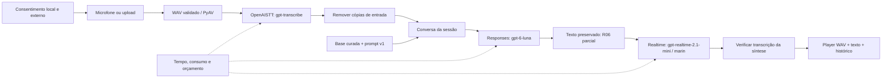

# Arquitetura — Etapa 02 OpenAI

A fundação foi evoluída sem microserviços, banco, autenticação ou integração governamental.
A versão anterior está em `stage01/architecture.md`. Base JSON 1.0.0, prompt v1,
contratos e memória contextual foram preservados.

## Responsabilidades e contratos

| Módulo | Contrato / comportamento |
| --- | --- |
| config | Settings: limites públicos validados; sem segredo |
| api_config | APIConfig: arquivo privado LOCALAPPDATA/VivaBairroVoz/.env, repr oculto e saída pública por lista permitida |
| api_runtime | SDK oficial com destinos fixos, timeout, retries/reconnect desligados no SDK; orçamento por tentativa; erros sanitizados |
| audio_input | AudioInput(path, source, sample_rate, channels, duration_seconds); WAV PCM 16 bits ou conversão limitada de formatos aceitos |
| stt | STTBackend -> Transcription(text, language, model_id, model_revision, usage); gpt-transcribe com languages=[pt] |
| knowledge | JSON versionado, cinco temas, proveniência explícita; contexto completo sem índice vetorial |
| conversation | Conversation por sessão; Message(system/user/assistant), pares limitados, commit após sucesso completo |
| llm | LLMBackend -> LLMResponse; Responses com instructions, histórico explícito, store=False, reasoning none e limite de tokens |
| speech_text | SpeechAdapter -> SpeechText; modo verbatim explícito, preserva texto; normalização automática pendente |
| tts | TTSBackend -> SynthesizedAudio; Realtime isolado, PCM mono 24 kHz em WAV, modelo/voz/consumo/metadados de fidelidade |
| privacy | Aviso v2, consentimentos separados para uso, áudio externo e texto externo; context manager transitório |
| pipeline | Orquestração e métricas; callback de progresso preserva transcrição/resposta mesmo se TTS falhar |
| session | Estado backend, pasta aleatória, contador persistente na sessão e lock; limpeza com fronteira de caminho |
| controller | Liga sessão aos adaptadores; descarte, expiração, limite de chamadas e erros por turno |
| app | FastAPI + HTML/CSS/JS; captura oculta antes do consentimento; player, transcrição, texto, histórico e métricas |

## Modelo de confiança

A chave é lida somente no backend. O cliente recebe apenas as opções públicas de operação. A classe de configuração esconde seu repr; o diagnóstico usa uma
lista explícita de campos públicos. O SDK recebe base_url e websocket_base_url
oficiais, para não herdar um destino alternativo de variáveis de ambiente.
Não há carregamento global de `.env`. Nenhuma credencial foi sobrescrita.

Consent.require verifica áudio e texto externos antes de qualquer chamada. A UI
inicia os três aceites desmarcados e a captura oculta. O estado da sessão nasce no
endpoint de autorização. O backend confirma os aceites antes de ler o upload e
novamente antes de iniciar o pipeline. O servidor escuta somente em loopback.

## Sessões e falhas

A aba mantém um identificador aleatório em memória e o envia por cabeçalho.
Cada identificador aponta para uma sessão do VoiceController. O histórico e os
WAVs pertencem à sessão. Um turno pode executar por vez, e os locks da sessão
protegem transcrição, limpeza e leitura do áudio. Chamadas enviadas ao provedor
durante um turno já iniciado seguem a política de retenção do provedor.

O usuário pode ver transcrição e resposta parcial ao fim de uma falha posterior,
mas o histórico para o LLM só recebe pares completos após TTS aceito. Não há fallback
silencioso. Autenticação, permissão, modelo inválido, timeout, conexão, limites e
conteúdo incompleto têm mensagens em português sem corpo bruto do provedor.

## TTS Realtime

Cada síntese cria uma sessão nova, sem histórico de conversa e sem ferramentas.
Após session.updated, response.create usa conversation=none e input=[]; as instruções
incluem o texto integral autorizado e exigem leitura literal, inclusive introduções
já contidas nele. Áudio é acumulado somente de response.output_audio.delta; a
transcrição de saída é verificada antes de gravar/liberar o WAV.

Só diferenças de caixa, pontuação e espaços são toleradas pelo comparador existente
em metrics. Ele não reescreve o texto para fala. Divergência descarta o áudio;
response.done incompleto, erro, timeout ou limite de bytes também impedem saída.
A comparação com a transcrição declarada pelo próprio modelo não substitui escuta
humana. Números e siglas podem gerar rejeição conservadora enquanto R06 estiver pendente.

## Arquivos e retenção

A raiz operacional é um TemporaryDirectory aleatório no temporário do usuário,
fora do OneDrive. A camada HTTP grava o corpo em uma pasta por requisição e aplica
limite de bytes e tempo durante o recebimento. O pipeline cria uma cópia transitória
que desaparece após STT ou falha. O controller também remove o upload nessa etapa.
A saída anterior some ao iniciar outro turno. Limpeza e revogação apagam saída e
histórico, conservando o contador. O TTL padrão é dez minutos, com varredura
a cada dez segundos e temporizador de limpeza no navegador.
Encerramento normal limpa a raiz. Queda abrupta, cópias do navegador e backups estão
fora dessa garantia. Retenção no provedor é independente.

## Latência, custos e reprodutibilidade

perf_counter mede input, STT, contexto, LLM, preparação textual e TTS. O total inicia
no handler após consentimento e termina com áudio pronto; não inclui gravação,
upload na rede, fila ou reprodução. A soma de etapas não precisa igualar o total.
playback_start_seconds permanece null, not_instrumented: não há medição de início
físico da fala. Um erro registra elapsed_to_failure_seconds e metadados das chamadas.

Orçamento por sessão: 30 tentativas; verifica capacidade mínima de três antes de
iniciar um turno. Cada retry explícito conta e pode consumir saldo. Verificador pago:
contador em disco, trava contra execução concorrente e máximo de 12 tentativas.
Não chama modelos durante importação, inicialização, unittest ou verify.py.
Consumo informado pela API fica separado de cobrança; cost_charged é null.
Aliases de modelos podem mudar: registrar o identificador solicitado e o informado
pela API; não inventar uma revisão quando ela não for fornecida.
