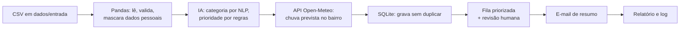

# VivaBairro — robô de triagem de relatos (RPA + IA)

Global Solution 2026.2 · FIAP · Tecnólogo em Inteligência Artificial
Disciplina: AI for Robotic Process Automation

| Integrante | RM |
| --- | --- |
| Gustavo Civita Gonçalves | 561932 |
| Rafael de Paiva Ramos | 563978 |
| Thiago Santana Danyluk | 562286 |

## 1. Problema e público

O VivaBairro é a solução CitizenTech do grupo: o morador relata um problema de zeladoria do bairro (buraco, calçada quebrada, falta de iluminação, lixo ou alagamento) e a IA ajuda a organizar o relato.

Este módulo cuida do que acontece depois que os relatos se acumulam. Uma equipe de zeladoria que recebe um lote de relatos precisa ler um por um, descartar os incompletos, separar por tipo e decidir o que atender primeiro. O robô faz essa triagem sozinho e entrega uma fila ordenada, uma lista do que precisa de revisão humana e um e-mail de resumo.

Público: moradores que relatam problemas, em especial pessoas com mobilidade reduzida, que dependem de calçadas e travessias em bom estado, e a equipe que recebe os relatos.

Este é um protótipo acadêmico. Ele não é um serviço público e não envia nada à prefeitura.

## 2. O que o robô faz



1. Lê todos os arquivos `.csv` de `dados/entrada/`. Arquivo quebrado é rejeitado e o robô segue para o próximo.
2. Valida cada linha. Linha inválida não entra no banco e vai para revisão humana com o motivo.
3. Troca CPF, telefone e e-mail por um marcador antes de guardar o texto.
4. Classifica a categoria do relato com NLP e sugere a prioridade com regras.
5. Consulta a chuva prevista para o bairro. Se a previsão for de 10 mm ou mais, relatos de drenagem sobem um nível de prioridade.
6. Grava no banco SQLite. O mesmo relato nunca é gravado duas vezes.
7. Gera `fila_priorizada.csv` e `revisao_humana.csv`.
8. Monta o e-mail de resumo. Envia se houver SMTP configurado; se não houver, salva em arquivo.
9. Escreve o relatório da execução e o log.

## 3. Como executar

Precisa de Python 3.10 ou mais novo.

```bash
pip install -r requirements.txt
python main.py
```

Não é preciso configurar nada. Os resultados aparecem em `saida/` e uma cópia vai para `evidencias/execucao/`.

No Windows, dois cliques em `rodar_tudo.bat` instalam as bibliotecas e rodam todos os comandos desta seção em sequência.

Outros dois comandos geram as evidências de validação:

```bash
python main.py avaliar    # mede a IA no conjunto de teste rotulado
python main.py falhas     # provoca falhas e registra o que o robô fez
python -m pytest -q       # 18 testes automatizados, sem internet
```

Para processar outros relatos, coloque um `.csv` com as colunas `data` (AAAA-MM-DD), `bairro` e `descricao` em `dados/entrada/`.

### Chaves e senhas

O robô não precisa de nenhuma chave para funcionar. A API de clima (Open-Meteo) é pública e não pede chave.

A única credencial possível é a do servidor de e-mail, e ela é opcional. Para enviar o e-mail de verdade, copie `.env.example` para `.env` e preencha `SMTP_HOST`, `SMTP_PORT`, `SMTP_USER`, `SMTP_PASSWORD` e `EMAIL_DESTINO`. O `.env` está no `.gitignore` e não vai para o repositório. Sem ele, o e-mail é salvo em `saida/emails/resumo.eml`.

## 4. Quadro de temas

Usamos quatro temas da disciplina. Cada um é uma etapa do fluxo: se for retirado, o robô deixa de entregar alguma coisa.

| Tema | Onde está no fluxo | O que resolve | Por que escolhemos |
| --- | --- | --- | --- |
| Tratamento de arquivos e dados (Pandas) | Etapas 1 a 3 e 7 · `robo/leitura.py` | Lê os lotes, rejeita arquivo quebrado, valida linha por linha, remove repetidos, mascara dados pessoais e gera as planilhas de saída. | Relatos chegam em lote e com erros de preenchimento. Sem essa etapa, lixo entra no banco. |
| Integração com API | Etapa 5 · `robo/clima.py` | Busca a chuva prevista por bairro e sobe a prioridade de relatos de drenagem quando vai chover forte. | Um bueiro entupido é mais urgente na véspera de chuva. Esse dado não está no relato; vem de fora. |
| Banco de dados SQL (SQLite) | Etapa 6 · `robo/banco.py` | Guarda os relatos com chave primária estável, impede duplicidade, ordena a fila por SQL e registra cada execução. | O robô roda todo dia. Sem banco, cada execução recomeçaria do zero e duplicaria relatos. |
| E-mail automatizado | Etapa 8 · `robo/email_resumo.py` | Entrega o resumo do dia à equipe, com contagens e os primeiros da fila. | A equipe não vai abrir uma pasta para olhar CSV. O resultado precisa chegar até ela. |

Não usamos web scraping nem RPA desktop. Os relatos chegam por arquivo e a previsão de chuva tem API pública, então raspar página ou clicar em tela deixaria o robô mais frágil sem ganho.

### A parte de IA

| Decisão | Como | Motivo |
| --- | --- | --- |
| Categoria | NLP clássico: TF-IDF + Regressão Logística (scikit-learn), treinado em 360 relatos sintéticos | Roda offline, de graça e em menos de 1 segundo. Devolve uma confiança, usada para decidir a revisão humana. |
| Prioridade | Regras com termos de risco e de baixa urgência (`robo/classificador.py`) | A regra aplicada fica gravada junto do relato, então quem revisa vê o motivo. |
| Revisão humana | Relato com confiança abaixo de 0,40 vai para `revisao_humana.csv` | O robô não decide sozinho quando não tem certeza. |

Não usamos LLM. O enunciado permite, e assim nenhum texto de cidadão sai da máquina.

Critério de prioridade usado nos rótulos e nas regras: **alta** é risco imediato a uma pessoa ou bloqueio de passagem para quem tem mobilidade reduzida; **baixa** é incômodo sem risco (pequeno, estético ou sem urgência); **média** é o resto.

## 5. Evidências de validação

Tudo o que está nesta seção foi gerado pelos comandos da seção 3 e está na pasta `evidencias/`. Medição de 19/11/2026.

### 5.1 IA medida em conjunto de teste rotulado

Teste: 60 relatos sintéticos escritos à mão, 10 por categoria, com categoria e prioridade rotuladas. Nenhum deles foi usado no treino. Detalhes em `evidencias/avaliacao.md`.

| Medida | Resultado |
| --- | --- |
| Categoria correta | 45 de 60 (75,0%) |
| Categoria correta entre os aceitos automaticamente | 38 de 45 (84,4%) |
| Relatos enviados para revisão humana | 15 de 60 |
| Erros de categoria que caem na revisão humana | 8 de 15 |
| Prioridade correta | 44 de 60 (73,3%) |
| Relatos de prioridade alta encontrados | 17 de 21 |

Análise dos erros:

- **Categoria.** O treino é montado por combinação de trechos, e o teste usa outra redação. O modelo erra quando o relato usa palavras que não viu ("paralelepípedo", "tapa-buraco") ou palavras de outra categoria ("água" em um relato de buraco).
- **Prioridade.** As regras dependem de palavras. Quatro relatos de risco passaram como média porque descrevem o risco sem usar nenhum termo da lista (por exemplo, "cachorro bravo avançando nas pessoas"). No sentido contrário, "a placa caiu" virou alta por causa da palavra "caiu".
- **Revisão humana.** Sete erros de categoria passaram com confiança acima de 0,40. A revisão humana reduz o erro, mas não o elimina.

### 5.2 Execução ponta a ponta

O lote de exemplo (`dados/entrada/relatos_2026-11-18.csv`) tem 22 linhas, com erros colocados de propósito. Resultado em `evidencias/execucao/`.

| Item | Valor |
| --- | --- |
| Linhas lidas | 22 |
| Linhas válidas, gravadas no banco | 17 |
| Linhas inválidas, enviadas para revisão humana | 4 |
| Linha repetida dentro do lote, ignorada | 1 |
| Relatos com dado pessoal mascarado | 1 |
| Relatos com baixa confiança, enviados para revisão humana | 1 |

O campo "API de clima" do relatório mostra se a API respondeu naquela execução. A regra da chuva depende da previsão do dia.

### 5.3 Casos de falha tratados

Gerado por `python main.py falhas`. Log de cada caso em `evidencias/falhas.md`.

| Falha provocada | O que o robô fez |
| --- | --- |
| Pasta de entrada vazia | Registrou o erro, não criou banco e encerrou com relatório. |
| Arquivo corrompido e arquivo sem as colunas | Rejeitou os dois, registrou o motivo e processou o lote válido (17 relatos gravados). |
| Linhas com dado inválido | 4 linhas ficaram fora do banco e foram para revisão humana com o motivo. |
| API de clima fora do ar | Tentou 3 vezes com espera crescente, registrou e seguiu sem o dado de chuva. |
| API responde com JSON fora do formato (resposta simulada) | Validou a resposta, tratou como falha e seguiu sem o dado de chuva. |
| Servidor de e-mail inexistente | Registrou a falha e salvou o e-mail em arquivo. |
| Mesmo lote processado duas vezes | Segunda execução: 0 relatos novos, 17 já existentes. |

### 5.4 Resiliência e segurança, em resumo

- Timeout de 5 s em toda chamada à API, 3 tentativas com espera de 1 s e 2 s.
- Depois de uma falha total da API, o robô não repete a espera para os outros bairros.
- Idempotência: o id do relato é um hash de data, bairro e descrição, e é chave primária.
- Toda falha vai para `saida/robo.log`. Toda execução gera `relatorio_execucao.md` e `.json`.
- Nenhuma chave ou senha no código. A única credencial é opcional e fica no `.env`.

### 5.5 Limites

- Todos os dados são sintéticos e foram escritos pelo próprio grupo, que também escreveu as regras. Com relatos reais o resultado deve ser pior.
- 60 relatos de teste é pouco: cada erro vale 1,7 ponto percentual.
- O limite de confiança (0,40) e o limite de chuva (10 mm) foram escolhidos pelo grupo, sem ajuste com dados reais.
- As coordenadas dos bairros são aproximadas. Bairro fora da tabela usa o centro da cidade.
- A resposta correta da API é coberta por teste automatizado com resposta simulada no formato da documentação e pela execução na máquina do grupo.

## 6. Proteção de dados, ética e ODS

O robô usa apenas dados sintéticos e trata o mínimo necessário: data, bairro e descrição. CPF, telefone e e-mail escritos no texto são trocados por um marcador antes de qualquer gravação. Para a API externa vão só a latitude e a longitude aproximadas do bairro; o texto do relato nunca sai da máquina. Do ponto de vista ético, a prioridade é uma sugestão: a regra aplicada fica registrada, os casos de baixa confiança vão para uma pessoa, e os erros medidos na seção 5 mostram que o robô não deve decidir sozinho o atendimento. Há ainda um risco de viés, porque bairros que relatam mais aparecem mais na fila; por isso a fila é ordenada por risco, e não por quantidade de relatos. O protótipo se relaciona com o ODS 11 (meta 11.7, espaços públicos seguros e acessíveis), ao priorizar barreiras para pessoas com mobilidade reduzida, e com o ODS 16 (meta 16.6, instituições eficazes e transparentes), ao deixar registrado o motivo de cada prioridade.

## 7. Organização do repositório

```
main.py                  ponto de entrada (rodar, avaliar, falhas)
rodar_tudo.bat           atalho para Windows: instala e roda tudo em sequência
robo/
  config.py              caminhos, limites e leitura do .env
  leitura.py             tema 1: arquivos e dados com Pandas
  classificador.py       IA: NLP para categoria, regras para prioridade
  clima.py               tema 2: API Open-Meteo com timeout, retry e caminho seguro
  banco.py               tema 3: SQLite
  email_resumo.py        tema 4: e-mail automatizado
  fluxo.py               orquestra as etapas e escreve o relatório
  avaliacao.py           mede a IA no conjunto de teste
  falhas.py              provoca falhas e registra o comportamento
  logs.py                log em arquivo e no console
dados/
  entrada/               lote de exemplo, com erros de propósito
  treino_relatos.csv     360 relatos sintéticos de treino
  teste_rotulado.csv     60 relatos sintéticos rotulados à mão
scripts/gerar_treino.py  gera o arquivo de treino
tests/test_robo.py       18 testes automatizados
evidencias/              resultados das execuções
.env.example             modelo de configuração do e-mail
```
